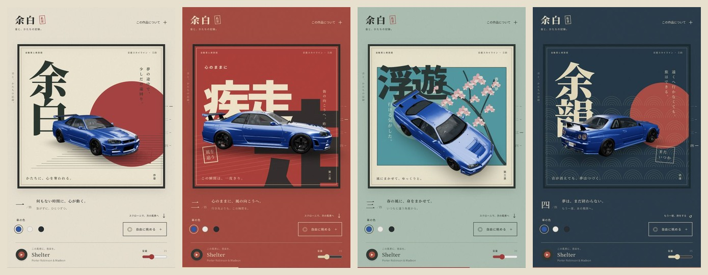
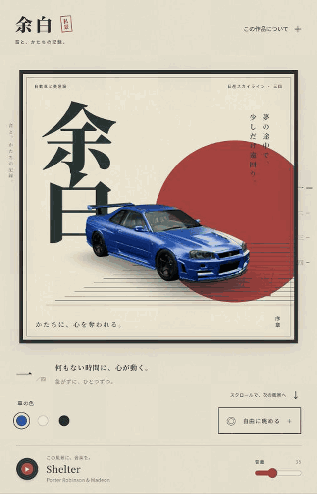

<div align="center">

# 余白 · YOHAKU

### Nissan Skyline GT-R R34 — a moving poster study

*音と、かたちの記録。*<br />
A small journey through Japanese print, color, and a car worth looking at twice.

[Getting started](#getting-started) · [Controls](#controls) · [Soundtrack](#optional-soundtrack) · [Credits](#credits--licensing)



</div>

An interactive, scroll-driven 3D experience built with **React, React Three Fiber, and GSAP**. One Nissan Skyline GT-R R34 Nismo Z-Tune moves through four original poster compositions: warm paper, vermilion ink, cherry blossoms, and indigo waves.

This is a personal visual experiment, inspired by Japanese print design and car culture. The interface is in Japanese; the controls below include English translations.

## In motion

<p align="center">
  
</p>

Recorded from the running app, about 15 seconds. The GIF is silent. A smaller [MP4 recording](docs/media/demo.mp4) is also included.

## Four scenes, one journey

| Scene | Mood | Composition |
| :--- | :--- | :--- |
| **一 · 余白** — Space | A quiet beginning | Warm paper, a vermilion sun, vertical serif type |
| **二 · 疾走** — Rush | Forward momentum | Cinema-poster lettering, red ink, graphic speed lines |
| **三 · 浮遊** — Float | A change in perspective | Teal, original SVG cherry blossoms, an elevated camera |
| **四 · 余韻** — Afterglow | One last look | Indigo, seigaiha waves, a view of the R34's rear wing |

### What you can do

- Scroll through a continuous camera journey, or jump directly to a chapter.
- Switch between **blue, ivory, and charcoal** paint without changing the model's badges, lights, or interior textures.
- Enter free-view mode and drag to orbit the car.
- Add a local soundtrack, with play/pause, volume, looping, and visible loading/error states.
- Use keyboard-accessible controls and a reduced-motion mode that also follows system preferences.
- Explore responsive poster layouts on narrow and wide screens.

## Getting started

**Requirements:** Node.js **22.12+** or **20.19+**, and npm. Use a browser with WebGL 2 and hardware acceleration.

```bash
git clone https://github.com/duyrk/yohaku.git
cd yohaku
npm ci
npm run dev
```

Open the local URL printed by Vite, normally **http://127.0.0.1:5173/**.

The repository includes the optimized R34 model and its decoder. **No account, API key, backend, or audio file is required to run the visual experience.** Fonts load from Google Fonts, with system fallbacks when offline.

| Command | Purpose |
| :--- | :--- |
| `npm run dev` | Start the local development server |
| `npm run build` | Check TypeScript and build into `dist/` |
| `npm run preview` | Preview the production build locally |

Stop a running server with **Ctrl+C** in its terminal.

## Controls

| On screen | Action |
| :--- | :--- |
| **一 / 二 / 三 / 四** | Jump to a poster scene |
| **車の色** | Change paint color |
| **自由に眺める** | Enter drag-to-orbit mode |
| **旅に戻る** | Return to the scroll-controlled camera |
| **もう一度、旅をする** | Replay the journey |
| **この作品について** | View credits and motion preferences; Escape closes the dialog |
| **▶ / Ⅱ** and **音量** | Play/pause audio and adjust volume |

## Optional soundtrack

The original personal demo uses **“Shelter” — Porter Robinson & Madeon**. **The recording is not distributed in this repository.** Audio files and local environment settings are ignored by Git.

To enable your own local copy:

1. Place the file at `public/audio/shelter.mp3`.
2. Copy `.env.example` to `.env.local`.
3. Set the following value and restart the development server:

   ```dotenv
   VITE_AUDIO_URL=/audio/shelter.mp3
   ```

Playback begins only after pressing the record button. Volume starts at 35%. The track continues between scenes, loops, and pauses when the page is hidden. Without an audio URL, the player stays disabled and the rest of the site works normally.

`VITE_` values are included in the browser bundle. Use them for public asset paths, never credentials. A production build copies files from `public/`, including any audio you add locally; only include recordings you have permission to distribute if you deploy your own build.

## Under the hood

| Layer | Tools |
| :--- | :--- |
| App | React 19, TypeScript, Vite 7 |
| 3D | Three.js, React Three Fiber, Drei |
| Motion | GSAP ScrollTrigger and `useGSAP` |
| Art direction | CSS print grain, original SVG illustration, Noto Serif JP / Noto Sans JP |
| Audio | Native HTML audio; no streaming service or external player |

A fixed WebGL canvas sits in front of the poster artwork. Native page scrolling updates one progress value; the camera interpolates between four poses in the render loop. React updates when a chapter or control changes, rather than on every scroll frame.

The model is oriented, centered, placed on the floor, and normalized to **4.6 scene units** at runtime. Material-name matching replaces only the paint and window materials. The original **22.03 MB** model was reduced to approximately **3.35 MB** using glTF Transform 4.5.1, mesh optimization, simplification, texture optimization, and Draco compression. Source attribution remains embedded in the GLB.

```text
src/
  App.tsx                3D scene, camera journey, chapters, controls
  PosterArt.tsx          Four posters; cherry blossom and wave SVGs
  Soundtrack.tsx         Optional audio player and playback states
  styles.css             Japanese typography, print texture, responsive layouts
  main.tsx               React entry point
public/
  models/skyline-r34.glb  Optimized R34 model
  models/LICENSE-skyline.txt
  draco/                 Local geometry decoder
  audio/                 Your local audio; not tracked
docs/media/              Recorded GIF, MP4, and scene overview
.env.example             Optional public audio path
```

### Make it yours

- **Camera:** edit `poses` in `src/App.tsx`.
- **Colors and text:** edit `chapters` and the paint options in `src/App.tsx`.
- **Posters:** edit `src/PosterArt.tsx` and `src/styles.css`.
- **Another car:** change the `useGLTF` path, material-name matching, and orientation; update the asset credits too.

## Credits & licensing

**Application code:** [MIT](LICENSE), © 2026 duyrk.

**3D model:** [“2005 Nismo Nissan Skyline R34 GTR Z Tune”](https://sketchfab.com/3d-models/2005-nismo-nissan-skyline-r34-gtr-z-tune-6a0e311f8c404fbaad783ed587014c1d) by **Ddiaz Design**, licensed under [CC BY-NC-SA 4.0](https://creativecommons.org/licenses/by-nc-sa/4.0/). The upstream description credits **CSR2 / GM25**. Downloaded via the credited copy in [Klmnz96/Nissan-Skyline-Landingpage](https://github.com/Klmnz96/Nissan-Skyline-Landingpage). This project optimizes the model and changes runtime paint, glass, orientation, and scale. The adapted model retains the same license. See [the complete asset notice](public/models/LICENSE-skyline.txt).

**Fonts:** Noto Serif JP and Noto Sans JP, served by Google Fonts. **Poster artwork:** original CSS/SVG compositions created for this project. **Music:** not included; the track's rights remain with its respective owners.

The model's **noncommercial/share-alike terms apply independently of the MIT code license**. This is an unofficial personal project, not affiliated with Nissan, Nismo, or the model artist.

---

<p align="center">急がずに、ひとつずつ。<br /><sub>One scene at a time.</sub></p>
